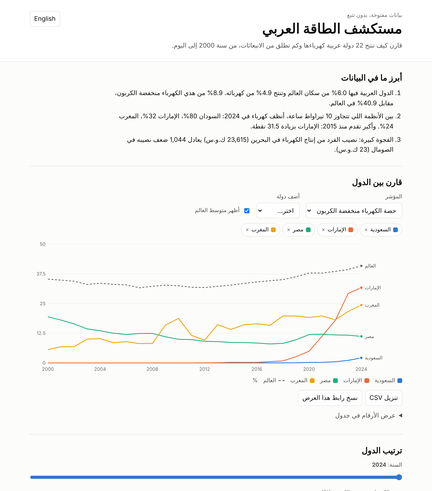

# Arab Energy Explorer | مستكشف الطاقة العربي

An interactive, Arabic-first website for exploring electricity and CO₂ data across the 22 Arab League countries, 2000–2024. It is a static site: no backend, no tracking, no cookies, no external scripts. All the data sits in one small file, so the page also works offline.



## شرح المشروع بالعربي

**وش يسوي المشروع؟**
موقع تفاعلي بالعربي والإنجليزي، تقارن فيه كيف تنتج 22 دولة عربية الكهرباء وكم تطلق من الانبعاثات، من سنة 2000 إلى 2024. تختار الدول والمؤشر، ويرسم لك الموقع المقارنة والترتيب وبطاقة لكل دولة، وفيه حاسبة "ماذا لو" للطاقة الشمسية.

**المشكلة اللي يحلها (مثال من الحياة اليومية):**
طالب يكتب بحث عن الطاقة ويبغى يعرف: هل المغرب سبق السعودية في الطاقة النظيفة؟ الأرقام موجودة، لكن في ملفات ضخمة بالإنجليزي. هنا يفتح الموقع من جواله، يختار الدولتين، ويشوف الجواب في رسم واحد بالعربي، ويقدر ينزّل الأرقام أو يرسل الرابط لزميله.

**كيف تشغّله؟**
افتح الملف `site/index.html` في أي متصفح (دبل كلك يكفي). ولتحديث البيانات:
```bash
pip install -r requirements.txt
python build_data.py        # ينزّل البيانات ويحدّث الموقع والنتائج
python -m pytest -q tests   # يشغّل الاختبارات
```

**أهم النتائج (2024):**
- الدول العربية فيها 6.0% من سكان العالم وتنتج 4.9% من كهربائه.
- 8.9% فقط من كهرباء الدول العربية منخفضة الكربون، مقابل 40.9% في العالم.
- بين الدول الكبيرة نسبياً: السودان 80% (أغلبها من الماء)، الإمارات 32%، المغرب 24%.
- مثال من الحاسبة: لو استبدلت السعودية 20% من كهرباء الوقود الأحفوري بالطاقة الشمسية، تحتاج قرابة 51 غيغاواط من الألواح، وتتجنب قرابة 59 مليون طن من الانبعاثات سنوياً. هذا حساب تقريبي مبني على افتراضات، مو توقع.

## Why it is useful

- **Arabic-first.** Data like this is usually published in English. Here every label, unit, term and note is in Arabic, right-to-left, with one-click English.
- **Reusable.** One script rebuilds everything when the source updates. To use another country group, change the `COUNTRIES` dictionary in `build_data.py`.
- **Light and private.** No libraries, no network calls after the page loads, about 70 KB of data, and nothing stored about the visitor.

## Features

| Section | What you can do |
|---|---|
| Compare | Line chart of 10 metrics for up to 6 countries plus the world, with hover values, a table view, CSV download and a shareable link |
| Ranking | All countries ranked on the chosen metric, for any year |
| Country card | Key figures against the world, and the electricity mix as a bar |
| What if | Replace a share of fossil electricity with solar and see capacity needed, emissions avoided and the new low-carbon share |
| Terms | Plain explanations of TWh, low-carbon, carbon intensity and capacity factor |

## Install and run

```bash
cd arab-energy-explorer
# View: open site/index.html in a browser. No server needed.

# Rebuild the data and run the checks:
pip install -r requirements.txt
python build_data.py              # downloads two OWID CSVs (~24 MB) into .cache/ (git-ignored)
python -m pytest -q tests         # the what-if tests need Node.js and are skipped without it
```

Outputs:

| File | Content |
|---|---|
| `site/data.js` | The data embedded in the site |
| `results/latest_by_country.csv` | All metrics for each country in the latest year |
| `results/findings.md` | Headline findings, written by the script from the data |
| `results/metadata.json` | Source URLs, SHA-256 of the files used, end year |

## Results (data downloaded 2026-11-03, latest year 2024)

From `results/findings.md`:

- Arab countries hold 6.0% of the world's people and generate 4.9% of its electricity. 8.9% of that electricity is low-carbon, against 40.9% for the world.
- Among systems above 10 TWh, the highest low-carbon shares are Sudan 80%, United Arab Emirates 32% and Morocco 24%. The largest gain since 2015 is the UAE, up 31.5 points.
- Generation per person in Bahrain (23,615 kWh) is 1,044 times that in Somalia (23 kWh).

Totals cover the 21 of 22 countries with 2024 data; Comoros has none for that year.

**What-if example, Saudi Arabia, 2024 data.** Replacing 20% of fossil generation (89 TWh) at a 20% capacity factor needs about 51 GW of solar, avoids about 59 Mt CO₂e a year, and lifts the low-carbon share from 2.2% to 21.7%.

## How the what-if works

Everything is in `site/calc.js`, and the tests run that same file.

- Solar capacity (GW) = replaced TWh × 1000 ÷ (8760 × capacity factor).
- Fossil intensity = grid carbon intensity × total generation ÷ fossil generation.
- Avoided Mt = replaced TWh × (fossil intensity − 48 g/kWh) ÷ 1000.

The 20% capacity factor is a round working assumption, adjustable on the page, and is not a measured value for any country. 48 g CO₂e/kWh is the median life-cycle figure for utility-scale solar in [IPCC AR5 WGIII, Annex III](https://www.ipcc.ch/report/ar5/wg3/).

## Data sources and licences

- **Our World in Data, Energy dataset**: <https://github.com/owid/energy-data>, **CC BY 4.0**. Electricity figures are compiled mainly from [Ember](https://ember-energy.org/) and the [Energy Institute Statistical Review](https://www.energyinst.org/statistical-review).
- **Our World in Data, CO₂ dataset**: <https://github.com/owid/co2-data>, **CC BY 4.0**. Emissions are compiled mainly from the [Global Carbon Project](https://globalcarbonbudget.org/).
- Raw CSVs are not committed. The SHA-256 of the copies used is in `results/metadata.json`.

## Limitations (please read)

- **Estimates.** Figures for small and conflict-affected countries often rest on rounded estimates (Sudan's 80% is one to read with care), so read them as a general direction.
- **The data stops at 2024.** The script ends at the latest year covering at least 75% of countries. 2025 has only 6 of 22, and one of those (Kuwait) repeats its 2024 value.
- **Nothing is filled in.** Missing values stay blank, and a missing source in the mix bar counts as zero.
- **Per person is generation ÷ population.** It includes industry and desalination, so it is not household use, and it misses unrecorded private generators.
- **Emissions are territorial.** They exclude exported oil and gas burned elsewhere.
- **The what-if is a simple illustration.** It holds total generation fixed and ignores storage, the timing of solar against demand, grid limits, cost and land. It also assigns all grid emissions to fossil plants, which slightly overstates the saving. Replacing 100% would not be feasible on solar alone.
- **Country list.** Arab League membership is used only as a way to group data; it carries no other meaning. Country names follow the source.
- **Browser testing.** Checked in headless Chromium at desktop and phone width, in both languages and colour schemes. Other browsers were not tested.

## Files

```
arab-energy-explorer/
├── build_data.py     # downloads, filters, writes site/data.js and results/
├── site/             # the website: index.html, styles.css, app.js, calc.js, data.js
├── tests/            # pytest: data pipeline, page structure, what-if maths
├── results/          # findings, latest-year table, metadata, screenshots
└── requirements.txt
```
