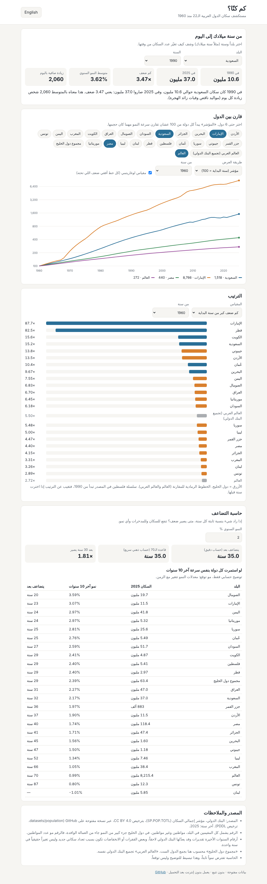
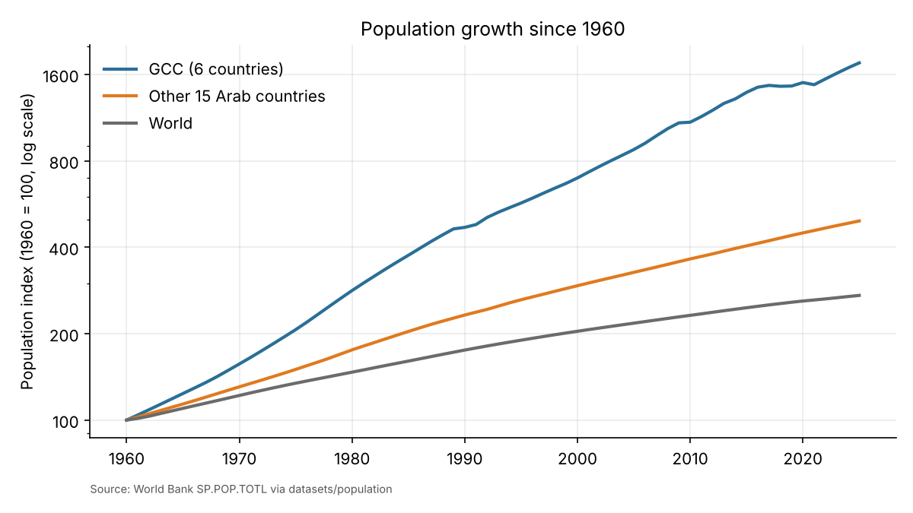
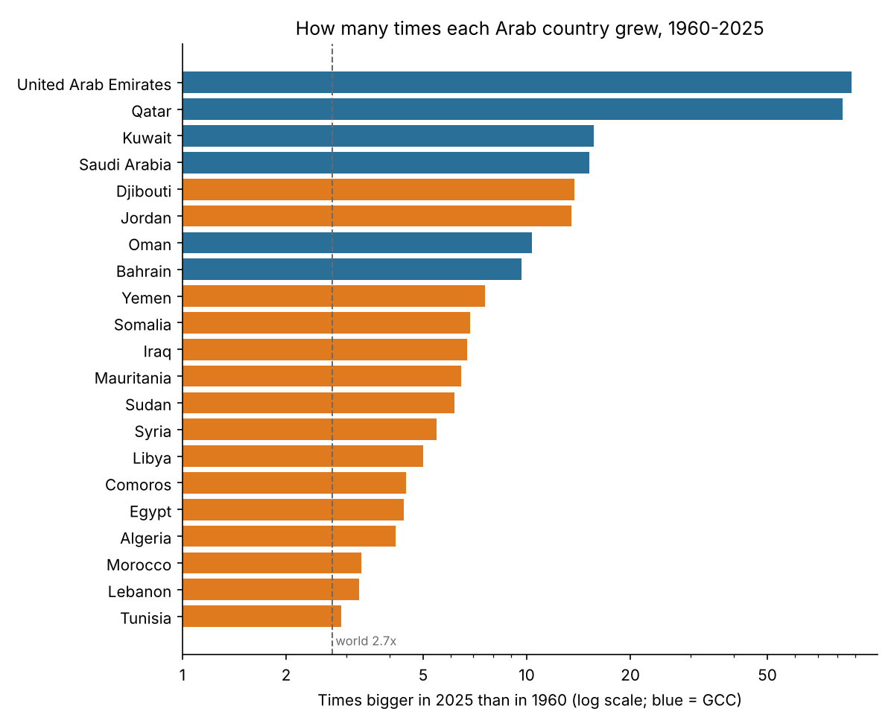

# How many were we? Arab Population Explorer (كم كنّا؟)

A small, bilingual (Arabic / English) static website that shows how the population of the
22 Arab League countries changed from 1960 to 2025, built on World Bank data. No backend,
no tracking, no external scripts: three local JS files and an embedded data file.



## شرح المشروع بالعربي

**وش يسوي المشروع؟** موقع بسيط تفتحه من الجوال أو الكمبيوتر، تختار فيه بلد عربي وسنة (مثلاً سنة
ميلادك)، ويقول لك كم كان عدد السكان وقتها وكم صار اليوم، وكم ضعف زاد، وكم شخص زاد بالمتوسط كل يوم.

**مثال من الحياة:** تبي تعرف «لما انولد أبوي سنة 1980، كم كان عدد سكان السعودية؟». الموقع يجاوبك:
حوالي 6 ملايين، واليوم 37 مليون، يعني أكثر من 6 أضعاف، وبمعدل حوالي 1,900 شخص زيادة كل يوم.

**وش فيه كمان؟**
- رسم يقارن نمو حتى 6 دول مع بعض (أو مع العالم ومجموع دول الخليج).
- ترتيب الدول العربية: مين كبر أكثر من سنة معينة.
- حاسبة «التضاعف»: لو شيء يزيد 2% كل سنة، متى يصير ضعف؟ (تنفع للسكان والمدخرات وأي نمو).

**كيف تشغله؟** افتح الملف `site/index.html` في المتصفح، بدون أي تثبيت. ولو تبي تحدّث البيانات:
`pip install -r requirements.txt` ثم `python build_data.py`.

**أهم نتيجة:** الدول العربية (21 دولة لها بيانات من 1960) زاد سكانها 5.4 مرات من 1960 إلى 2025،
بينما العالم كله زاد 2.7 مرات بس. والإمارات وقطر زادت أكثر من 80 ضعف، والسعودية 15 ضعف تقريباً،
وأغلب هذا النمو في الخليج جاء من العمالة الوافدة وليس المواليد فقط.

## Why it is useful

- **Plain-language numbers.** "15x since 1960" or "about 1,900 more people a day" is easier to grasp
  than a column of World Bank figures. Useful for students, journalists, teachers and anyone
  writing about the region.
- **Arabic-first.** Most population explorers are English-only; this one is RTL Arabic by default
  (English one click away), with Latin digits for readability.
- **Honest and checkable.** Every number comes from one cited public source, the build script
  records the SHA-256 of the file it used, and the formulas in the page (`site/calc.js`) are tested
  to match the Python ones (`popcalc.py`).
- **Reusable.** `build_data.py` works for any set of World Bank country codes; change the
  `COUNTRIES` dictionary to build the same site for another region.

## Features

1. **From your birth year to today**: population then and now, times bigger, average yearly growth,
   net people added per day.
2. **Compare countries**: up to 6 series, index (start year = 100) or absolute millions, optional log
   scale, any start year.
3. **Ranking**: times bigger, average yearly growth or latest population, from any start year;
   GCC states highlighted, World and Arab World shown as references.
4. **Doubling calculator**: exact doubling time vs the "rule of 70" shortcut, plus how long each
   country would take to double if it kept its 2015-2025 pace (labelled as an illustration, not a
   forecast).

Works at phone width (tested at 390 px, no horizontal scroll), follows the system dark mode, and
remembers the language choice in the browser only.

## Install and run

```bash
cd arab-population-explorer
pip install -r requirements.txt
python build_data.py          # downloads the CSV, writes site/data.js and results/
python -m pytest -q           # 18 tests: formulas, JS/Python parity, pipeline, site checks
# then open site/index.html in a browser (or serve the folder with `python -m http.server`)
```

`python build_data.py --csv population.csv` uses a local copy instead of downloading.

## Data sources and licenses

| What | Source | License |
|---|---|---|
| Total population, 1960-2025 (indicator `SP.POP.TOTL`) | [World Bank, World Development Indicators](https://data.worldbank.org/indicator/SP.POP.TOTL) | [CC BY 4.0](https://datacatalog.worldbank.org/public-licenses) |
| Same series as a CSV (the file actually downloaded) | [`datasets/population` on GitHub](https://github.com/datasets/population) | [ODC-PDDL 1.0](https://opendatacommons.org/licenses/pddl/1-0/) |

The World Bank compiles this series from the UN World Population Prospects, national censuses and
statistical offices. The exact file used is recorded in `results/metadata.json` (SHA-256).
The "GCC total" is computed here as the sum of the six GCC states; "Arab World" is the World Bank's own
aggregate. Country names follow the earlier projects in this portfolio.

## Results (measured in this run, 1960-2025)

From `results/findings.md` and `results/summary_by_country.csv`:

- The 21 Arab League countries with data back to 1960 grew from **91.5 million to 497.9 million
  people (5.4x)**, versus **2.7x for the world**; their share of the world population rose from
  3.0% to 6.1%.
- Fastest growth since 1960: **UAE (88x), Qatar (83x), Kuwait (16x)**; Saudi Arabia grew
  **15.2x (2.4 million to 37.0 million)**. Slowest: Tunisia (2.9x).
- The six GCC states went from 3.9% to 12.7% of the population of those 21 countries.
- 2015-2025 average growth: fastest Somalia (3.59%/yr) and the UAE (3.07%/yr); Lebanon was the only
  country to shrink (-1.01%/yr). At its recent pace Saudi Arabia (2.17%/yr) would double in about 32
  years, the world (0.99%/yr) in about 70.




## Limitations

- **Residents, not citizens.** The series counts everyone living in the country. In the GCC a large
  share of growth is foreign workers, so these numbers say nothing about citizen birth rates.
- **Estimates and revisions.** Recent years (especially 2024-2025) are World Bank estimates and get
  revised. Year-to-year dips (e.g. Saudi Arabia in 2010, 2018, 2019 and 2021) can reflect census
  rebasing or migration and should not be read as precise annual changes.
- **Coverage.** The source's Palestine series (West Bank and Gaza) starts in 1990, so it is excluded
  from comparisons that start earlier; the site says so where it applies.
- **Mirror lag.** The GitHub mirror is updated periodically and may trail the World Bank's own site.
- **The doubling numbers are arithmetic, not forecasts.** Constant growth is a simplification; real
  population projections (e.g. UN WPP) model births, deaths and migration explicitly.

## Folder layout

```
arab-population-explorer/
├── build_data.py      downloads data, writes site/data.js, results/, charts
├── popcalc.py         growth formulas (mirrored in site/calc.js)
├── requirements.txt
├── site/              the website: index.html, styles.css, app.js, calc.js, data.js
├── results/           findings.md, summary_by_country.csv, charts, metadata, screenshots
└── tests/             pytest: formulas, JS parity, pipeline, static site checks
```

## Publishing on GitHub Pages

This repository's Pages site is served from the `gh-pages` branch, which the owner manages. To publish,
copy `site/` into that branch as `arab-population-explorer/`; it will then be at
`https://algilani2008.github.io/data-portfolio/arab-population-explorer/`.

Data © World Bank (CC BY 4.0). The repository has no LICENSE file yet, so reuse of the code is subject to the owner's choice of license.
