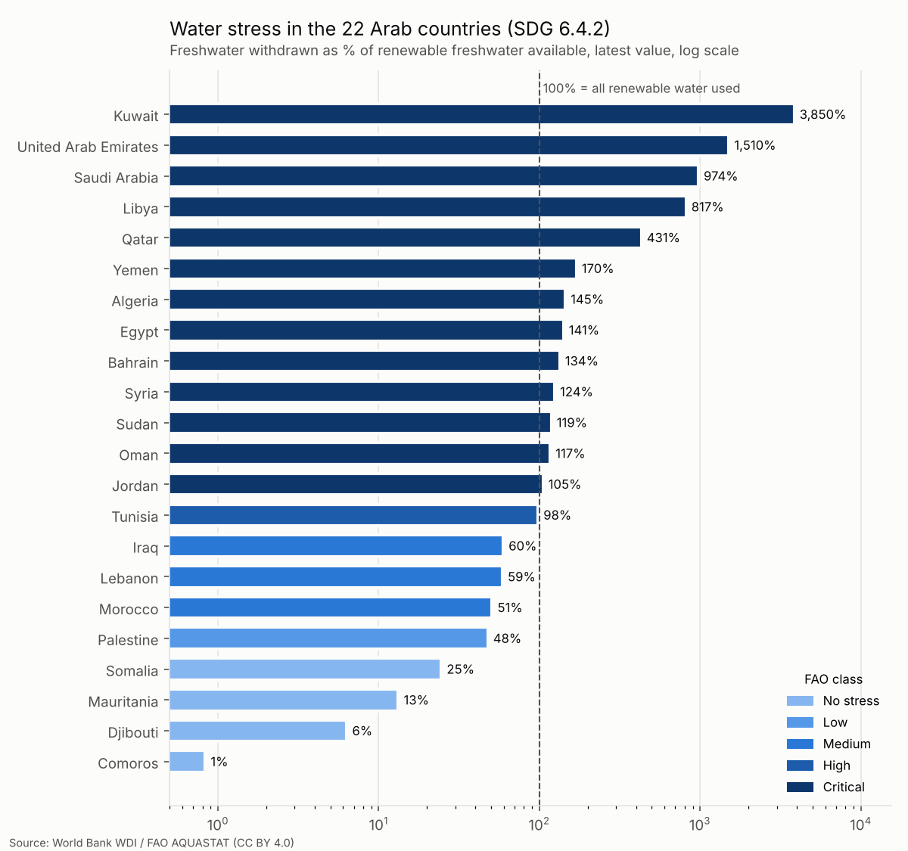
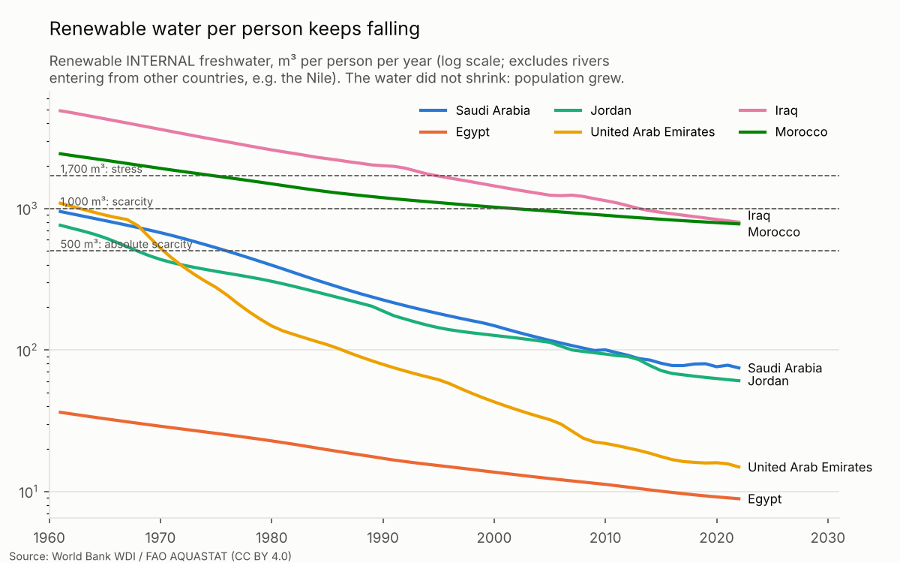
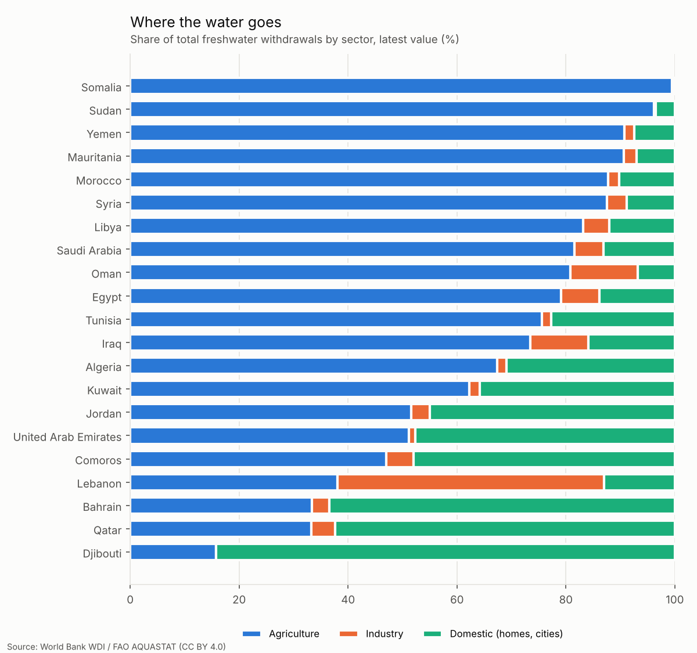
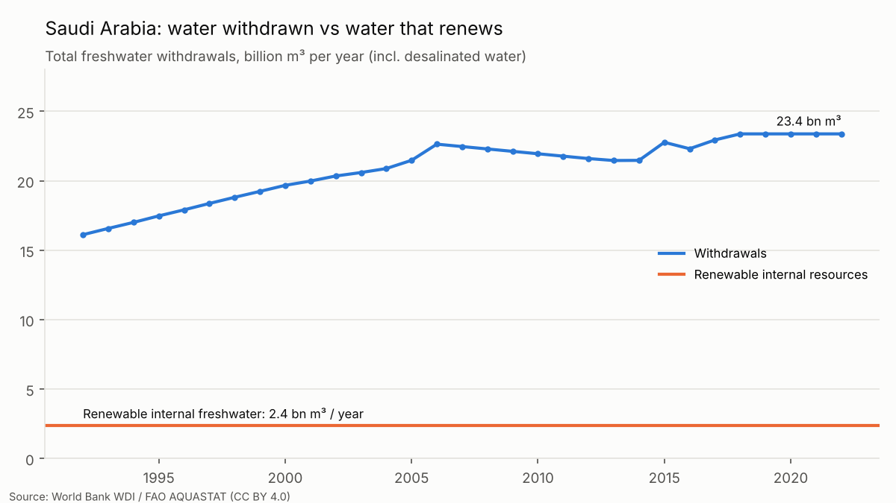

# Arab Water Stress: how much water the 22 Arab countries use vs how much renews

A reproducible data analysis of freshwater scarcity in the 22 member states of the
League of Arab States, built on the official SDG 6.4.2 water-stress indicator and
related FAO AQUASTAT series published in the World Bank's World Development
Indicators. One command downloads the pinned data, recomputes everything, writes
tables and charts, and generates the findings text, so every number below comes
from code, not from hand-typing.



## شرح المشروع بالعربي

**وش يسوي المشروع؟** يقارن بين كمية المياه العذبة اللي تسحبها كل دولة عربية في السنة
(للزراعة والصناعة والبيوت) وكمية المياه اللي "تتجدد" طبيعياً كل سنة من الأمطار والأنهار
والمياه الجوفية المتجددة. لو السحب أكبر من المتجدد، معناه الدولة تعيش على مخزون قديم
(مياه جوفية ما ترجع) أو على تحلية مياه البحر.

**مثال من الحياة اليومية:** تخيّل راتبك الشهري 1,000 ريال (هذا "المتجدد")، وأنت تصرف
10,000 ريال في الشهر (هذا "السحب"). الفرق تغطيه من مدخراتك أو من مصدر ثاني مكلف.
هذا تقريباً وضع المياه في السعودية: السحب حوالي 9.7 أضعاف المياه المتجددة داخلياً،
والفرق يجي من المياه الجوفية غير المتجددة ومن التحلية.

**كيف تشغّله؟**
```bash
pip install -r requirements.txt
python build.py        # ينزّل البيانات ويطلع الجداول والرسوم في مجلد results
python -m pytest -q    # يشغّل الاختبارات
```

**النتيجة الرئيسية:**
- 13 دولة عربية من 22 تسحب مياه أكثر من اللي يتجدد عندها كل سنة (مستوى "حرج" حسب تصنيف الفاو).
- الأعلى: الكويت ثم الإمارات ثم السعودية (974%).
- نصيب الفرد السعودي من المياه المتجددة نزل من 916 متر مكعب في 1962 إلى 75 متر مكعب في 2022،
  مو لأن المياه قلّت، بل لأن عدد السكان زاد كثير.
- الزراعة تستهلك أغلب المياه: 82% من السحب في السعودية.

**تنبيه مهم:** أغلب الأرقام الأخيرة تقديرات قديمة تتكرر كل سنة (مثلاً رقم السعودية آخر تغيّر
في 2018)، والمشروع يوضح هذا لكل دولة بدل ما يوهم إن الرقم حديث.

## Why it is useful

- **One honest, reusable table** of water stress for the whole Arab region, with the
  year each number was *last actually updated* (most AQUASTAT values are carried
  forward for years; this project detects and reports that instead of hiding it).
- **Saudi / Gulf focus**: water is one of the region's defining constraints, yet the
  official numbers are scattered. This puts them in one place with sources.
- **Data-quality checks built in**: per-person water is recomputed from totals and
  population to verify the published series, and sector shares that do not add up to
  100% are flagged and excluded instead of being charted.
- **Reproducible**: the source is pinned to one Git commit and every downloaded file's
  SHA-256 is recorded in `results/metadata.json`.

## Install and run

```bash
cd arab-water-stress
pip install -r requirements.txt
python build.py              # downloads ~1.2 MB of CSVs into raw_cache/ (git-ignored)
python build.py --offline    # re-run from the cache only
python -m pytest -q          # 26 tests
```

Python 3.9+; pure pandas + matplotlib. No API keys.

## Results

Generated by `build.py` (full text in [`results/findings.md`](results/findings.md)):

1. **13 of 22 Arab countries withdraw more freshwater than renews each year**
   (SDG 6.4.2 water stress above 100%, FAO class "Critical"). Highest: Kuwait 3,850%,
   United Arab Emirates 1,510%, Saudi Arabia 974%.
   Class counts: No stress 4, Low 1, Medium 3, High 1, Critical 13.
2. **Saudi Arabia: water stress 974%** (value last changed in 2018). Withdrawals
   23.4 bn m³/year vs 2.4 bn m³ of renewable internal freshwater, i.e. **9.7x** what
   renews. Withdrawals were 16.1 bn m³ in 1992.
3. **Renewable water per person fell in 19 of 20 countries** with data in both 1962
   and 2022 (Kuwait has zero renewable internal freshwater in both years; Sudan and
   Palestine lack one of the two years). Countries below 500 m³ per person ("absolute
   scarcity", Falkenmark) went from 6 to 16. Saudi Arabia: 916 → 75 m³ per person
   (−92%). For reference, the median country in the world had 2,536 m³ in 2022.
4. **Agriculture uses most of the water**: over half of withdrawals in 16 of 21
   countries (median 76%). Saudi Arabia: agriculture 82%, industry 5%, domestic 13%.
5. **Water productivity** (constant 2015 US$ of GDP per m³ withdrawn): Saudi Arabia
   $36.8/m³ vs $23.2/m³ for the median country in the world.

| Chart | What it shows |
|---|---|
|  | Renewable internal water per person, 1961–2022, with Falkenmark thresholds |
|  | Agriculture / industry / domestic share of withdrawals |
|  | Saudi withdrawals vs renewable internal resources |

Output tables in [`results/`](results/): `water_stress_latest.csv`,
`water_per_person.csv`, `withdrawals_by_sector.csv`, `saudi_withdrawals.csv`,
`water_productivity.csv`, plus `metadata.json`.

## Method

- **Water stress (SDG 6.4.2)** = total freshwater withdrawal ÷ (total renewable
  freshwater resources − environmental flow requirements) × 100. Classes follow FAO:
  <25% no stress, 25–50 low, 50–75 medium, 75–100 high, ≥100 critical.
- **Falkenmark classes** for renewable water per person: ≥1,700 m³ no stress,
  1,000–1,700 stress, 500–1,000 scarcity, <500 absolute scarcity.
- **Latest value vs last change**: for each country the script reports the latest
  year in the data and the first year of the final run of identical values
  (`last_changed_year`). For 18 of 22 countries the latest water-stress value is
  carried forward from an earlier estimate.
- **Checks**: renewable internal resources ÷ population reproduces the published
  per-person series (median relative difference < 0.01%). Sector shares must sum to
  100% ± 1.5; Palestine's latest shares sum to 114.6% in the source, so it is
  excluded from the sector chart and statistics and named in the findings.

## Data sources and licenses

| Data | Source | License |
|---|---|---|
| Water stress, withdrawals (total and by sector), renewable internal freshwater, water productivity | [FAO AQUASTAT](https://data.apps.fao.org/aquastat/) via the [World Bank World Development Indicators](https://datacatalog.worldbank.org/search/dataset/0037712) | [CC BY 4.0](https://creativecommons.org/licenses/by/4.0/) |
| Population | UN World Population Prospects and national sources via the World Bank WDI | [CC BY 4.0](https://creativecommons.org/licenses/by/4.0/) |
| Mirror used for download | [open-numbers/ddf--open_numbers--world_development_indicators](https://github.com/open-numbers/ddf--open_numbers--world_development_indicators) (Gapminder), commit `1bd7fac42b3d5012353607bf2464a485557fd049` | Mirror: MIT; underlying data CC BY 4.0 |

The World Bank API itself was not reachable from the build environment, so the
GitHub mirror of the same WDI series is used and pinned to a commit. Raw data is
downloaded at run time, not committed.

## Limitations (read before quoting a number)

- **Old estimates**: AQUASTAT updates countries irregularly. Many "2022" values are
  copies of a 2005–2018 estimate, and years between estimates are often interpolated.
  Use `last_changed_year` when quoting.
- **Internal vs total resources**: the per-person chart uses *internal* renewable
  water only, which excludes rivers entering from other countries. That is why Egypt
  (Nile) and Iraq (Tigris–Euphrates) look scarcer there than in the stress indicator,
  which does include external inflows.
- **Withdrawals include desalinated water** where significant, so stress above 100%
  does not by itself mean aquifers are being depleted by that amount; it means the
  country relies on non-renewable groundwater and/or desalination.
- **Water productivity** divides GDP by water use; oil- and gas-heavy economies score
  high regardless of water efficiency, so compare it with care.
- World references are the **median country** (unweighted), not a population-weighted
  world average.
- Country-level only: no regional or city detail, no projection of the future.

## Files

```
arab-water-stress/
├── build.py           download (pinned), analysis, charts, findings
├── water.py           pure functions: classes, latest/carried-forward detection, checks
├── tests/test_water.py
├── requirements.txt
└── results/           generated tables, charts, findings.md, metadata.json
```
