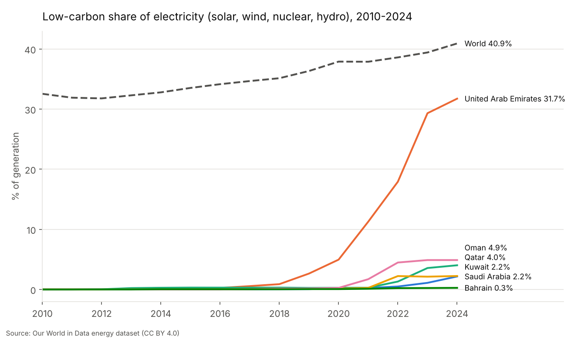
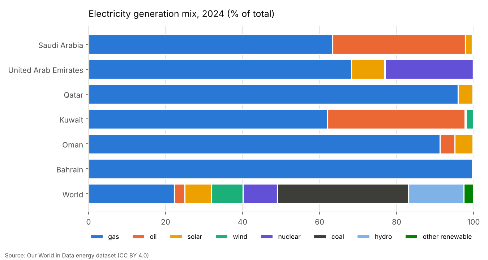
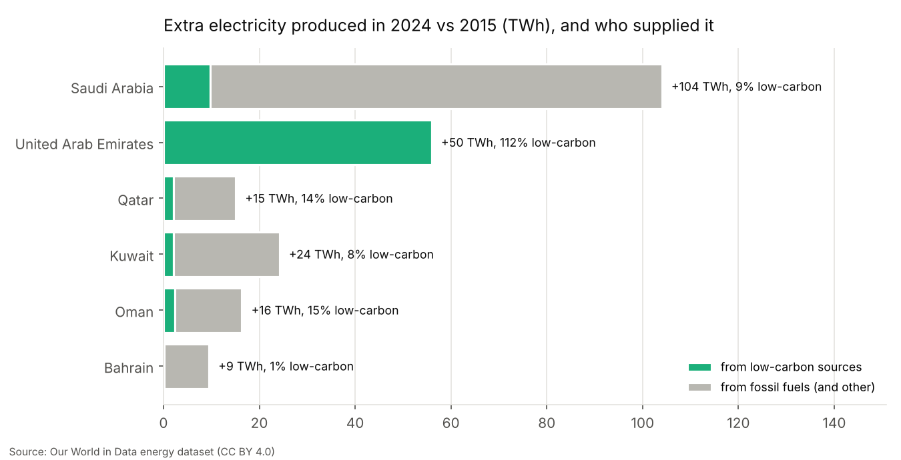
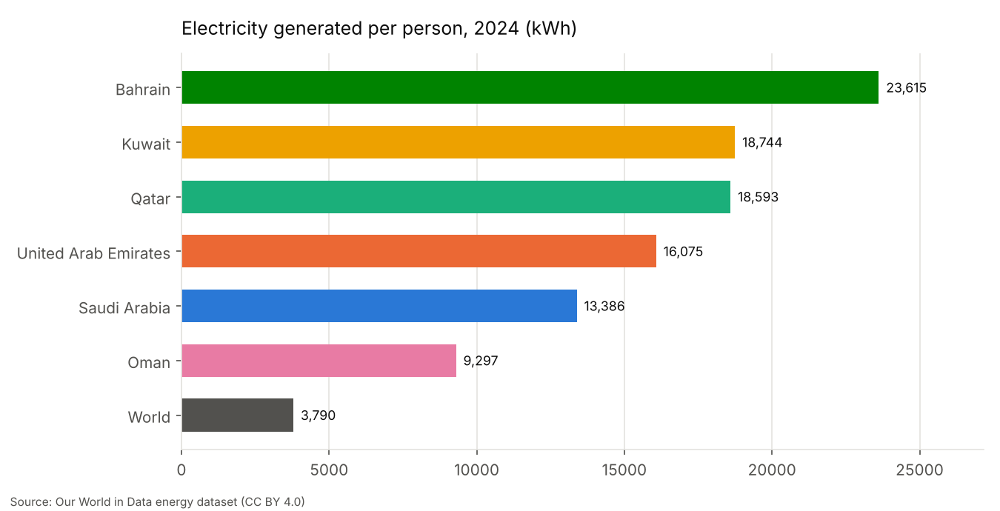

# GCC Electricity Transition, 2000–2024

How the six Gulf Cooperation Council countries (Saudi Arabia, UAE, Qatar, Kuwait, Oman, Bahrain) make their electricity, how fast demand has grown, and how much of that growth has been met by low-carbon sources (solar, wind, nuclear, hydro). Built on the open [Our World in Data energy dataset](https://github.com/owid/energy-data); every number in this folder is produced by `run_analysis.py`.



## شرح المشروع بالعربي

**وش يسوي المشروع؟**
يحلّل كيف تنتج دول الخليج الست الكهرباء: كم منها من الغاز، وكم من النفط، وكم من الطاقة النظيفة (الشمس والرياح والنووي). ويقارنها ببعض وبالعالم من سنة 2000 إلى 2024.

**المشكلة اللي يحلها (مثال من الحياة اليومية):**
تسمع في الأخبار عن محطات الطاقة الشمسية الجديدة وتتساءل: "هل فعلاً صارت كهرباء بيتي تجي من الشمس؟". المشروع يجاوب بالأرقام: الكهرباء اللي نستهلكها زادت كثير، والسؤال المهم هو: الزيادة هذي من وين جات؟ من محطات نظيفة ولا من حرق غاز ونفط أكثر؟

**كيف تشغّله؟**
```bash
pip install -r requirements.txt
python run_analysis.py      # ينزّل البيانات ويطلع الجداول والرسوم في مجلد results
python -m pytest -q tests   # يشغّل الاختبارات
```

**أهم النتائج (2024):**
- الإمارات متقدمة بوضوح: قرابة 32% من كهربائها من مصادر نظيفة (أغلبها من محطة براكة النووية، وجزء من الطاقة الشمسية).
- بقية دول الخليج كلها تحت 5%، والمتوسط العالمي قرابة 41%.
- في السعودية: حصة النفط في إنتاج الكهرباء نزلت من حوالي 53% سنة 2015 إلى حوالي 35% سنة 2024 (حلّ الغاز مكانه غالباً)، والطاقة النظيفة ارتفعت من شبه صفر إلى حوالي 2%.
- الكهرباء الإضافية اللي انتجتها دول الخليج بين 2015 و2024: حوالي ثلثها فقط من مصادر نظيفة، والباقي من الغاز والنفط.
- كل دولة خليجية تنتج كهرباء للفرد أكثر من المتوسط العالمي بـ 2.5 إلى 6 أضعاف (بسبب التكييف والصناعة الثقيلة وتحلية المياه).

## Why it is useful

- One reproducible script turns a 23,000-row global dataset into a clear GCC comparison: CSV tables, four charts and an auto-written findings file.
- The headline metric, *share of new electricity met by low-carbon sources*, answers a sharper question than "what is the renewable share": it shows whether new demand is being met cleanly.
- `gcc_power.py` is a small, tested helper module you can reuse for other country groups (change the `GCC` dict).

## Install and run

```bash
cd gcc-electricity-transition
pip install -r requirements.txt
python run_analysis.py             # downloads the OWID CSV (~9 MB) into .cache/ (git-ignored)
python run_analysis.py --offline   # re-run from the cached copy
python -m pytest -q tests
```

Outputs in `results/`:

| File | Content |
|---|---|
| `gcc_electricity_timeseries.csv` | Yearly indicators, 2000–2024, six GCC countries + World |
| `generation_mix_2024.csv` | Share (%) of each source in 2024 generation |
| `summary_by_country.csv` | Headline indicators per country (growth, per-capita, carbon intensity, oil share, low-carbon share of growth) |
| `findings.md` | The findings below, written by the script from the data |
| `metadata.json` | Source URL, licence, SHA-256 of the downloaded file, latest common year |
| `charts/*.png` | Four charts |

## Results (data downloaded 2026-11-01, latest year with data for all six countries: 2024)

| Country | Generation 2024 (TWh) | Growth/yr 2000–24 | kWh per person | Low-carbon share 2024 | Low-carbon share of 2015–24 growth | gCO2e/kWh |
|---|---:|---:|---:|---:|---:|---:|
| Saudi Arabia | 454.6 | 5.1% | 13,386 | 2.2% | 9% | 692 |
| UAE | 177.3 | 6.4% | 16,075 | 31.7% | 112%* | 468 |
| Qatar | 56.7 | 7.9% | 18,593 | 4.0% | 14% | 582 |
| Kuwait | 92.5 | 4.5% | 18,744 | 2.2% | 8% | 635 |
| Oman | 49.1 | 7.3% | 9,297 | 4.9% | 15% | 543 |
| Bahrain | 38.0 | 4.3% | 23,615 | 0.3% | 1% | 902 |
| World | 30,930 | 3.0% | 3,790 | 40.9% | 67% | 471 |

\* Above 100% means low-carbon output grew by more than total generation, so fossil-fuel generation in the UAE actually fell between 2015 and 2024.

Key findings (see `results/findings.md`):

1. **The UAE is the GCC outlier**: 31.7% low-carbon electricity in 2024 (nuclear 22.9% from Barakah, solar 8.6%). Every other GCC country is at or below 4.9%.
2. **Saudi Arabia is switching oil for gas**: oil fell from 52.8% (2015) to 34.5% (2024) of generation; low-carbon rose from ~0% to 2.2%.
3. **New demand is still mostly fossil**: of the ~219 TWh of extra electricity produced across the GCC between 2015 and 2024, about 33% came from low-carbon sources, almost all of it in the UAE.
4. **Very high per-person generation**: 2.5x (Oman) to 6.2x (Bahrain) the world average.





## Data source and licence

- **Our World in Data – Energy dataset**, <https://github.com/owid/energy-data>, licensed **CC BY 4.0**. OWID compiles electricity figures mainly from the [Energy Institute Statistical Review of World Energy](https://www.energyinst.org/statistical-review) and [Ember](https://ember-energy.org/) (CC BY 4.0); see the OWID codebook for per-column sources. Please cite: *Our World in Data, Energy dataset, via github.com/owid/energy-data*.
- The raw CSV is not committed; it is downloaded by the script. The SHA-256 of the copy used for the committed results is in `results/metadata.json`.

## Limitations (please read)

- **Data are revised.** OWID updates the file; re-running later can change numbers slightly. The committed results match the file with the SHA-256 in `metadata.json`.
- **Common end year.** Some countries already have 2025 rows (Kuwait's 2025 generation equals its 2024 value, suggesting a carried-forward estimate), so the analysis stops at 2024, the latest year all six have.
- **"Per person" is generation divided by population**, not household use. It includes industry (e.g. aluminium smelting in Bahrain), desalination and, in Bahrain and Qatar, a large non-citizen population; it is not a measure of individual behaviour.
- **Low-carbon** follows OWID's definition (renewables + nuclear). Carbon intensity is OWID/Ember's life-cycle gCO2-equivalent per kWh of generation.
- Small national figures (especially Bahrain before 2000 and very small solar/wind values) can carry large relative uncertainty.
- This is descriptive analysis; it does not forecast or evaluate any policy.

## Files

```
gcc-electricity-transition/
├── gcc_power.py        # reusable helpers: download, select, mix shares, CAGR, growth decomposition
├── run_analysis.py     # builds everything in results/
├── tests/              # pytest unit tests (no network needed)
├── results/            # example output generated by run_analysis.py
└── requirements.txt
```
