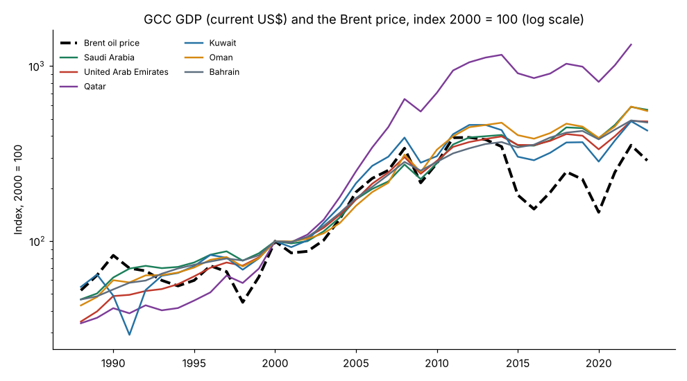
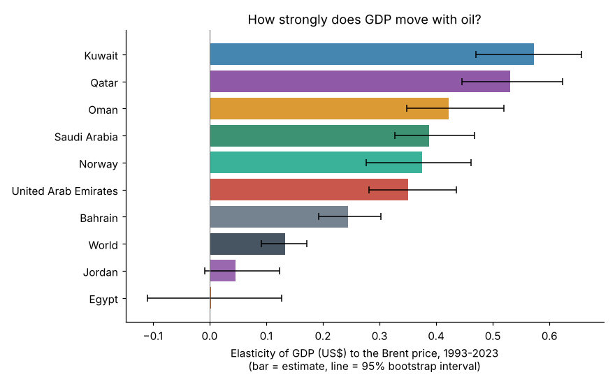
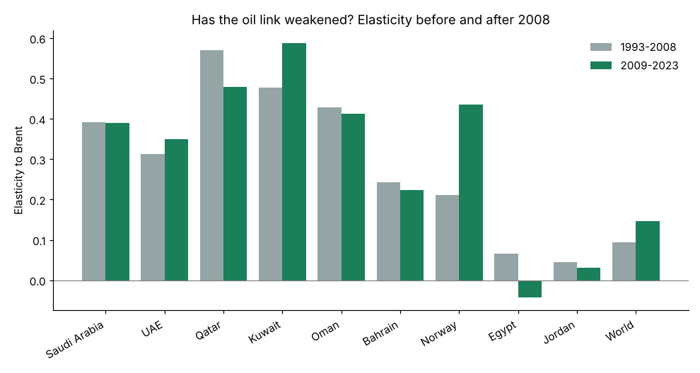
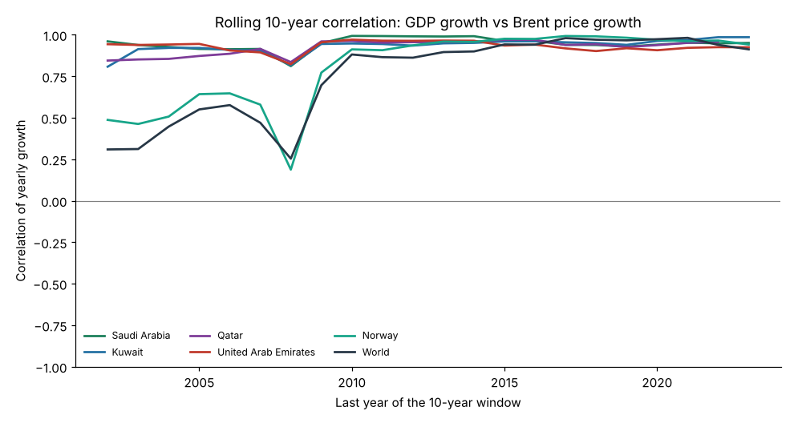
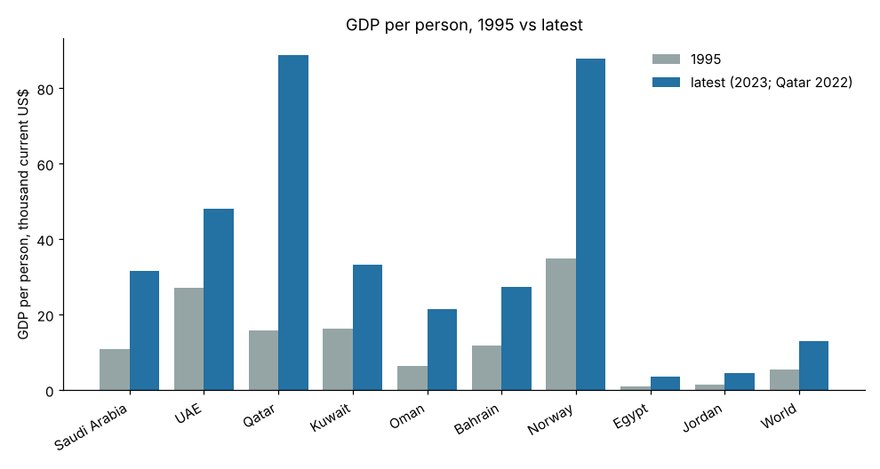

# Gulf economies and the oil price (1988–2023)

How closely does the size of each Gulf economy move with the price of oil, and has that link weakened over time?
This project measures it with real public data for the six GCC countries (Saudi Arabia, UAE, Qatar, Kuwait, Oman, Bahrain), compared with Norway (an oil exporter with a large sovereign fund), Egypt and Jordan (non-Gulf neighbours) and the world as a whole.



## شرح المشروع بالعربي

**وش يسوي المشروع؟** يقيس كم يتأثر حجم اقتصاد كل دولة خليجية (الناتج المحلي الإجمالي بالدولار) بسعر برميل النفط (برنت)، سنة بسنة من 1993 إلى 2023، ويقارنها بالنرويج ومصر والأردن والعالم.

**مثال من الحياة اليومية:** مثل موظف راتبه فيه عمولة على المبيعات؛ لو نزلت المبيعات ينزل دخله. المشروع يسأل: كم "عمولة النفط" في دخل كل دولة خليجية؟ يعني إذا ارتفع سعر النفط 10%، كم يكبر الاقتصاد بالدولار؟

**كيف تشغّله؟**
```bash
pip install -r requirements.txt
python run_analysis.py      # ينزّل البيانات ويطلع الجداول والرسوم في results/
python -m pytest tests      # يشغّل الاختبارات
```

**النتيجة الرئيسية:**
- في السعودية: كل ما ارتفع سعر النفط 10% في سنة، كبر الناتج المحلي بالدولار تقريباً **3.9%** زيادة (المقياس = 0.39). في العالم ككل الرقم **1.3%** بس، وفي مصر تقريباً **صفر**.
- أعلى ارتباط بالنفط في الكويت (0.57) وقطر (0.53)، وأقل شي في البحرين (0.24).
- **قوة الارتباط السنوي ما ضعفت بشكل واضح** بين فترة 1993–2008 وفترة 2009–2023 (السعودية 0.39 في الفترتين).
- لكن **حجم الاقتصاد نفسه كبر أسرع من سعر النفط**: من 2000 إلى 2023 تضاعف اقتصاد السعودية بالدولار 5.6 مرات، بينما سعر النفط زاد 2.9 مرات بس. ولما طاح النفط 56% بين 2014 و2016، نزل الاقتصاد السعودي بالدولار 13% فقط.
- **تنبيه:** الأرقام بالدولار الجاري (مو بعد خصم التضخم)، وهذا ارتباط وليس إثبات سبب ونتيجة.

## Why it is useful

- Gives a simple, reproducible number (the *elasticity*) for "how oil-dependent is this economy's dollar GDP", with uncertainty intervals rather than a single point.
- Separates two questions that are often mixed up: *does GDP still swing with oil each year?* (yes, as much as before) and *has the economy grown beyond what oil prices alone would explain?* (yes, clearly since 2000).
- All code is small, tested and re-runnable; the helper module `oil_gdp.py` can be reused for any country or commodity price.

## Method

For each country and period we regress yearly log-growth of GDP (current US$) on yearly log-growth of the annual-average Brent price:

`Δlog(GDP_t) = a + b · Δlog(Brent_t) + e_t`

`b` is the elasticity: `b = 0.4` means that in a year when Brent rose 10%, dollar GDP grew about 4% more than in a year with a flat oil price. The 95% interval is a bootstrap over years (2,000 resamples, fixed seed).

- Full period: growth years 1993–2023 (starts after the 1990–91 Gulf War, which distorted Kuwait's GDP for reasons unrelated to oil prices).
- Early vs late: 1993–2008 vs 2009–2023.
- Rolling 10-year correlation of the two growth rates.
- GDP per person, 1995 vs latest year, plus annual growth of GDP per person and of population.

## Install and run

```bash
cd gulf-oil-gdp-link
pip install -r requirements.txt
python run_analysis.py          # downloads data into .cache/ (git-ignored), writes results/
python run_analysis.py --refresh  # force a fresh download
python -m pytest tests -q
```

## Results (measured in this run)

Elasticity of GDP (current US$) to Brent, growth years 1993–2023 (`results/elasticities.csv`):

| Country | Elasticity | 95% interval | Correlation |
|---|---|---|---|
| Kuwait | 0.57 | 0.47 – 0.66 | 0.92 |
| Qatar (to 2022) | 0.53 | 0.45 – 0.62 | 0.89 |
| Oman | 0.42 | 0.35 – 0.52 | 0.89 |
| Saudi Arabia | 0.39 | 0.33 – 0.47 | 0.93 |
| Norway | 0.38 | 0.28 – 0.46 | 0.85 |
| UAE | 0.35 | 0.28 – 0.44 | 0.91 |
| Bahrain | 0.24 | 0.19 – 0.30 | 0.86 |
| World | 0.13 | 0.09 – 0.17 | 0.76 |
| Jordan | 0.05 | -0.01 – 0.12 | 0.25 |
| Egypt | 0.00 | -0.11 – 0.13 | 0.01 |

Findings:

1. **GCC dollar GDP is about three times as sensitive to oil as world GDP** (GCC median 0.40 vs 0.13). Year-to-year growth correlations with Brent are around 0.9 for every GCC country.
2. **No clear weakening of the year-to-year link.** Early vs late elasticities: Saudi Arabia 0.39 → 0.39, UAE 0.31 → 0.35, Qatar 0.57 → 0.48, Kuwait 0.48 → 0.59, Oman 0.43 → 0.41, Bahrain 0.24 → 0.22. The 95% intervals of the two periods overlap for every country, so none of these changes is statistically clear.
3. **But the level of GDP has outgrown the oil price.** From 2000 to 2023 Brent rose 2.9× (US$28.5 → 82.5) while dollar GDP rose 5.6× in Saudi Arabia, 4.8× in the UAE and Bahrain, 4.3× in Kuwait, 5.6× in Oman and 13.3× in Qatar (2000–2022). When Brent fell 56% from 2014 to 2016, Saudi dollar GDP fell 13%.
4. **GDP per person** (current US$, 1995 → 2023) rose from about 10.8k to 31.7k in Saudi Arabia; population grew 3.4% a year over the same period, much faster than the world (1.2%).

Charts: `results/charts/` · full findings: `results/findings.md` · data provenance with SHA-256 hashes: `results/metadata.json`.

| | |
|---|---|
|  |  |
|  |  |

## Limitations (please read)

- **Nominal, not real, GDP.** GDP is in current US dollars. For oil exporters, a higher oil price raises the dollar value of the same barrels, so part of the elasticity is a *price* effect, not more real activity. Real (inflation-adjusted) and non-oil GDP series were not reachable from this environment; adding them is the most useful next step.
- **Correlation, not causation.** Oil prices and GDP are both driven by the global business cycle (the world's own elasticity is 0.13).
- **Short samples.** Sub-periods have 14–16 years, so intervals are wide; differences between countries whose intervals overlap should not be over-read.
- **Coverage.** Qatar's GDP in this World Bank mirror ends in 2022; the other series end in 2023. Brent is the annual mean of monthly EIA prices; 1987 and 2026 are partial years and are excluded.
- **Exchange rates.** Most GCC currencies are pegged to the US dollar (Kuwait's to a basket), so US-dollar GDP is a fair comparison inside the GCC, but less so for Egypt, whose currency was devalued several times.
- This is an economic description, not investment or trading advice.

## Data sources and licenses

| Data | Original source | Mirror used | License |
|---|---|---|---|
| GDP, current US$ (NY.GDP.MKTP.CD) | [World Bank WDI](https://data.worldbank.org/indicator/NY.GDP.MKTP.CD) | [datasets/gdp](https://github.com/datasets/gdp) | CC BY 4.0 |
| Population, total (SP.POP.TOTL) | [World Bank WDI](https://data.worldbank.org/indicator/SP.POP.TOTL) | [datasets/population](https://github.com/datasets/population) | CC BY 4.0 (World Bank); mirror packaged as ODC-PDDL |
| Brent spot price, monthly | [U.S. EIA](https://www.eia.gov/dnav/pet/hist/RBRTEm.htm) | [datasets/oil-prices](https://github.com/datasets/oil-prices) | U.S. government public domain; mirror ODC-PDDL |

Raw data is downloaded at run time and not committed. The derived tables in `results/` are shared under the same attribution terms (please credit the World Bank and EIA).

## Files

- `oil_gdp.py` – pure, reusable helpers (annual averaging, log growth with gap handling, OLS elasticity with bootstrap CI, rolling correlation, CAGR).
- `run_analysis.py` – downloads data, runs the analysis, writes `results/`.
- `tests/test_oil_gdp.py` – pytest unit tests.
