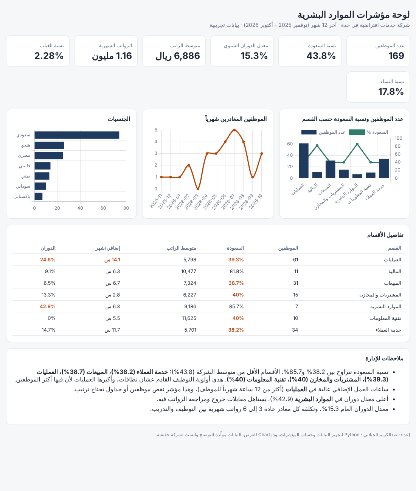

# لوحة مؤشرات الموارد البشرية

لوحة تفاعلية لمؤشرات الموارد البشرية لشركة خدمات افتراضية في جدة (169 موظف)، تغطي آخر 12 شهر.

🌐 [فتح اللوحة](https://algilani2008.github.io/data-portfolio/hr-kpi-dashboard/)

## المؤشرات

- **عدد الموظفين، ونسبة السعودة** (حسب القسم، مع تمييز الأقسام الأقل من متوسط الشركة)
- **معدل الدوران الوظيفي** السنوي وحسب القسم، والمغادرين شهرياً
- **متوسط الراتب** وإجمالي الرواتب الشهرية
- **نسبة الغياب** وساعات العمل الإضافي لكل قسم
- **توزيع الجنسيات** ونسبة النساء
- **ملاحظات للإدارة** تنكتب تلقائياً من الأرقام (أولويات السعودة، الأقسام اللي فيها ضغط عمل إضافي، أعلى دوران)

## طريقة العمل

1. `build.py` يولّد بيانات موظفين تجريبية واقعية (الأقسام، الجنسيات، تاريخ التعيين والمغادرة، الرواتب، الغياب، الإضافي) ويحفظها في `employees.csv`.
2. نفس السكربت يحسب المؤشرات بنفس تعريفات الموارد البشرية المعتادة (الدوران = المغادرين ÷ متوسط عدد الموظفين) ويحفظها في `kpis.json`.
3. القالب `template.html` يعرضها بـ Chart.js، ويشتغل على الجوال والكمبيوتر، والوضع الليلي.

لتشغيله على بيانات حقيقية: استبدل `employees.csv` بتصدير من نظام الموارد البشرية (نفس الأعمدة) وشغّل `python build.py`.

## المهارات

Python (تجهيز البيانات وحساب المؤشرات)، Chart.js وHTML/CSS، مؤشرات الموارد البشرية ونطاقات (السعودة).

> البيانات مولّدة للتوضيح، وليست لشركة حقيقية.
