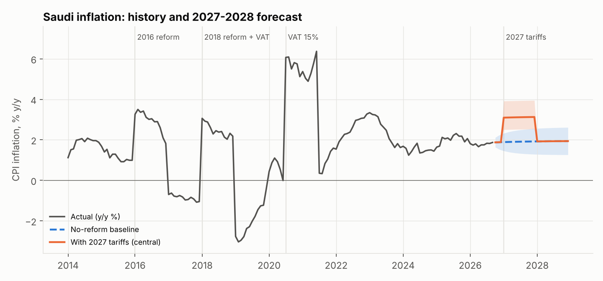
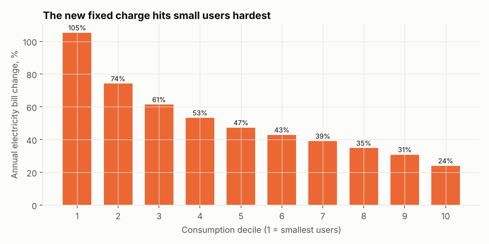
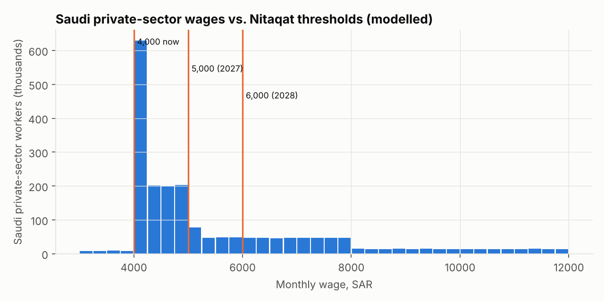
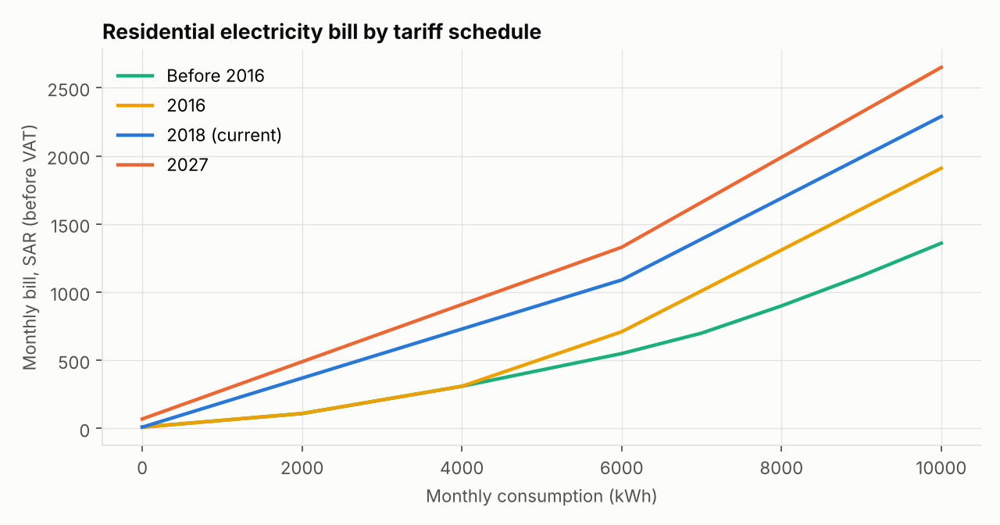
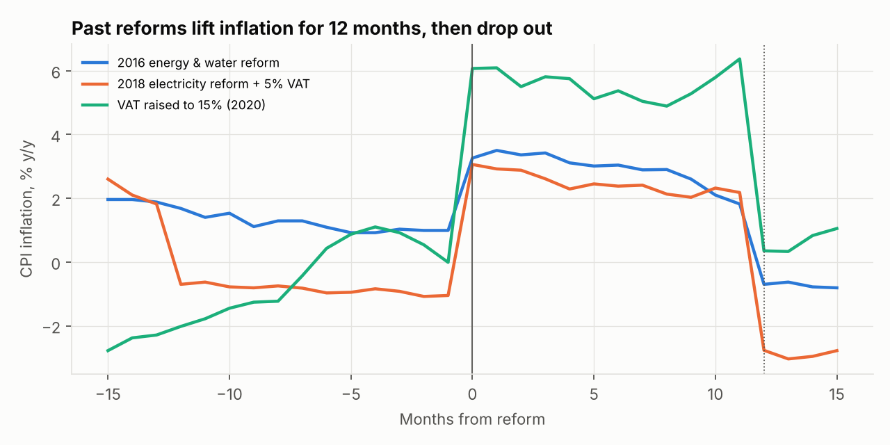
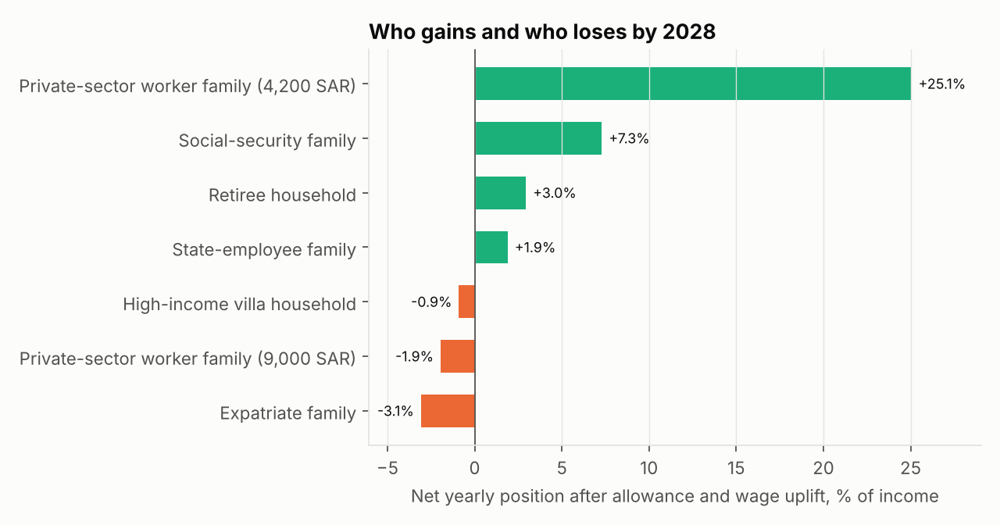
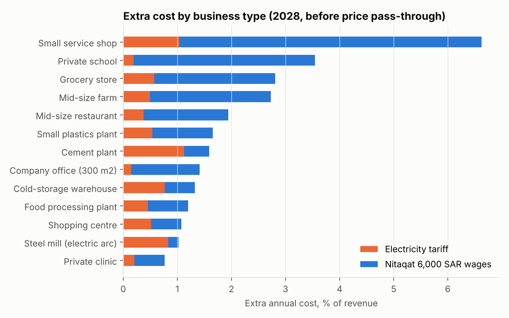

# واط وأجر: تعرفة الكهرباء والمياه والأجور في السعودية

**Watt & Wage: Saudi utility tariffs, wages and their impact on households, society, commerce and industry (2016 – 2030)**

مشروع تحليل بيانات متكامل عن قرارات 25 أكتوبر 2026: رفع تعرفة الكهرباء والمياه من 1 يناير 2027، وبدل 500 ريال، ورفع حد احتساب السعودي في نطاقات إلى 5,000 ثم 6,000 ريال. يحلل المشروع الأثر على أربعة مستويات: الأسرة، والمجتمع، والقطاع التجاري، والقطاع الصناعي. ويقارن خيارات الحلول للأسر والمنشآت والسياسة العامة، ويقدّم توقعات حتى 2030.

**لوحة المؤشرات التفاعلية:** [`dashboard/index.html`](dashboard/index.html). فيها 9 تبويبات بالعربية والإنجليزية: نظرة عامة، والأفراد، والمجتمع، والتجاري، والصناعي، وسوق العمل، ومختبر التضخم، والحلول، والمنهجية. وتتضمن حاسبة فاتورة الأسرة مع تقدير الاستهلاك من المكيفات، وحاسبة المنشأة (الكهرباء + أجور نطاقات)، ومحاكي حد الأجور ونسبة الامتثال، ومختبر تضخم بمؤشرات قابلة للتحريك، ومحاكي إجراءات الترشيد والطاقة الشمسية.



## أهم النتائج

| المؤشر | القيمة |
|---|---|
| متوسط زيادة فاتورة الكهرباء السكنية السنوية | **+34.8%** (من 3,860 إلى 5,201 ريال، شامل الضريبة ومع استجابة الاستهلاك) |
| متوسط زيادة فاتورة المياه والصرف | **+58.5%** |
| زيادة فاتورة أصغر 10% من المستهلكين مقابل أكبر 10% | **+105%** مقابل **+24%** |
| منزل متوسط (1,550 كيلوواط و43 م³ شهرياً) | من 5,206 إلى 8,018 ريال سنوياً (**+2,812 ريال**) |
| التضخم المتوقع 2027 (مركزي) | **3.1%** مقابل 1.9% بدون الإصلاح (80% من المحاكاة بين 2.5% و3.7%) |
| التضخم المتوقع 2028 | **1.9%**: الصدمة تخرج من المقارنة السنوية بعد 12 شهراً |
| سعوديون في القطاع الخاص تحت 5,000 ريال | نحو **1.30 مليون** (48%). التكلفة على المنشآت نحو 12.6 مليار ريال سنوياً |
| سعوديون تحت 6,000 ريال | نحو **1.52 مليون** (57%). التكلفة نحو 31.8 مليار ريال سنوياً |
| تكلفة بدل 500 ريال على الدولة | نحو **32 مليار ريال** سنوياً (النطاق 26 – 37) |

- **الرسوم الثابتة هي القصة الأكبر.** رسوم العداد ترتفع من 10 – 30 ريالاً إلى 70 – 100 ريال، والمياه تضيف 30 ريالاً ثابتة. لذلك يتحمّل صغار المستهلكين، وغالبهم أسر الشقق، أعلى نسبة زيادة.
- **البدل يغطي الزيادة لمن يستحقه.** في الأسر النموذجية الأربع، يغطي بدل 6,000 ريال سنوياً الزيادة كاملة، حتى للفيلا الكبيرة جداً (102%). أما موظف القطاع الخاص فلا يحصل على البدل، ويتحمّل الزيادة كاملة.
- **الإصلاحات السابقة كانت صدمات لمرة واحدة.** قفز التضخم 2.3 نقطة في يناير 2016، و4.1 في يناير 2018، و6.1 في يوليو 2020. وتراجع بالمقدار نفسه تقريباً بعد 12 شهراً، ونسبة التماثل بين 0.99 و1.20.
- **سابقة 2020 تدعم امتثال المنشآت.** عند رفع حد نطاقات إلى 4,000 ريال كان تحته 660,497 سعودياً. في الربع الثاني 2026 بقي تحته نحو 67 ألفاً فقط (−90%)، ووسيط الأجر اليوم 5,050 ريالاً، أي فوق الحد الجديد بقليل.

<table><tr>
<td></td>
<td></td>
</tr><tr>
<td></td>
<td></td>
</tr></table>

## الأثر على المجتمع: من يربح ومن يخسر؟

| الأسرة | زيادة الفواتير/سنة | التعويض | الصافي بحلول 2028 | % من الدخل |
|---|---|---|---|---|
| موظف قطاع خاص (4,200 ريال) | +2,060 | رفع الراتب إلى 6,000 عبر نطاقات | **+19,540** | +25.1% |
| أسرة ضمان اجتماعي | +2,060 | بدل 500 ريال | +3,940 | +7.3% |
| متقاعد | +2,812 | بدل 500 ريال | +3,188 | +3.0% |
| موظف حكومي | +2,812 | بدل 500 ريال | +3,188 | +1.9% |
| أسرة دخل مرتفع (فيلا) | +4,337 | لا شيء | −4,337 | −0.9% |
| موظف قطاع خاص (9,000 ريال) | +2,812 | لا شيء | −2,812 | −1.9% |
| **أسرة مقيمة** | +2,060 | لا شيء | **−2,060** | **−3.1%** |

- **فجوة التغطية:** نحو 44% فقط من الأسر ذات العدادات تحصل على بدل. لا يشمل التعويض الأسر المقيمة (نحو 2.5 مليون) ولا الأسر السعودية التي ليس فيها موظف حكومي أو متقاعد أو مستفيد من الضمان.
- **الأثر البيئي:** ينخفض الاستهلاك السكني نحو 3.1%، أي قرابة 5,000 جيجاواط ساعة سنوياً. يعني هذا تجنّب 3.4 مليون طن CO₂ ونحو 2.6 مليون برميل نفط سنوياً، وينخفض استهلاك المياه المنزلي نحو 7.5%.



## القطاع التجاري والصناعي

- **الرسوم الثابتة غير السكنية ترتفع بشدة:** من 10 – 30 ريالاً إلى 350 / 500 / 700 / 900 ريال للتجاري والصناعي والحكومي، وإلى 140 – 200 ريال للزراعي والخيري.
- **التكلفة الإضافية على القطاعات:** التجاري نحو **8.5 مليار ريال** سنوياً (منها 5.5 مليار رسوم ثابتة)، والصناعي **3.5 مليار**، والحكومي **2.1 مليار**، والزراعي **0.8 مليار**.
- **في التجارة، الأجور أثقل من الكهرباء:** في محل خدمات صغير، يكلّف رفع حد نطاقات 5 أضعاف زيادة الكهرباء، والإجمالي يعادل 55% من صافي الربح. وفي المطعم المتوسط، الإجمالي 1.9% من الإيرادات.
- **في الصناعة الثقيلة، الكهرباء هي الأثقل:** مصنع الحديد يتحمّل نحو 15 مليون ريال كهرباء إضافية سنوياً مقابل 3.4 مليون أجوراً. ومصنع الإسمنت يخسر 1.1% من إيراده، أي 9% من ربحه.
- **فحص اتساق النموذج:** لو مرّر القطاع الخاص نصف تكلفته الإضافية (12.7 مليار) للأسعار، فذلك يضيف نحو 0.38 نقطة للتضخم. وهذا قريب من الأثر غير المباشر المفترض في نموذج التضخم (0.31 نقطة).



## الحلول

**للأسرة:** ضبط المكيف على 24 درجة، وإضاءة LED، وإطفاء الأجهزة في وضع الاستعداد، ومرشّدات المياه. تكلف هذه الإجراءات معاً نحو 1,350 ريالاً، وتعوّض **64%** من زيادة المنزل المتوسط و**98%** للفيلا الكبيرة. والتعرفة الجديدة تقصّر فترة استرداد كل إجراء: مثلاً، مكيفات الانفرتر من 12.4 إلى 10.6 سنة، والطاقة الشمسية من 15.2 إلى 13.2 سنة. أما الطاقة الشمسية المنزلية فتبقى ضعيفة الجدوى لأن سعر بيع الفائض للشبكة 7 هللات فقط.

**للسياسة العامة: مقارنة البدائل**

| الخيار | التكلفة (مليار/سنة) | المستفيدون (مليون) | يشمل المقيمين | يشمل القطاع الخاص |
|---|---|---|---|---|
| الحزمة المعلنة: 500 ريال للمستحقين | 32.1 | 2.9 أسرة | ✗ | ✗ |
| شريحة حماية: أول 1,000 كيلوواط بالسعر القديم | 3.0 | 9.2 حساب | ✓ | ✓ |
| خفض الرسم الثابت للقواطع الصغيرة إلى 30 ريالاً | 2.8 | 5.0 حساب | ✓ | ✓ |
| استرداد كامل الزيادة لأصغر 30% من المستهلكين | 2.8 | 2.7 حساب | ✓ | ✓ |
| دعم نصف زيادة أجر نطاقات للسنة الأولى | 5.7 | 1.3 عامل | ✗ | ✓ |

البدائل التي تعمل عبر الفاتورة أرخص بنحو 10 أضعاف، وتسد فجوة المقيمين وموظفي القطاع الخاص. لكنها تعوّض الأسرة نقداً أقل بكثير من البدل. لهذا قد يكون المزيج بين الحزمة المعلنة وأحد هذه البدائل أكثر عدالة.

**للمنشآت:** خفض سعة القاطع إن أمكن، فالانتقال من 300+ إلى 200 – 299 أمبير يوفر 2,400 ريال سنوياً. وكذلك تحديث التكييف والإضاءة، وتركيب الطاقة الشمسية على الأسطح التجارية لأن سعر الكيلوواط التجاري 25 – 35 هللة، وتخطيط زيادات الأجور قبل أبريل 2027، وتمرير تدريجي للأسعار بنسبة 1 – 3%.

## التوقعات 2025 – 2030

| السنة | التضخم % | حد نطاقات | مكسب أجور السعوديين (مليار) | تكلفة البدل (مليار) | CO₂ يُتجنب (مليون طن) |
|---|---|---|---|---|---|
| 2026 | – | 4,000 | 0 | 0 | 0 |
| 2027 | 3.1 | 5,000 | 7.5 | 32.1 | 3.8 |
| 2028 | 1.9 | 6,000 | 22.7 | 32.1 | 3.9 |
| 2029 | 1.9 | 6,000 | 28.4 | 32.1 | 4.0 |
| 2030 | 1.9 | 6,000 | 28.4 | 32.1 | 4.1 |

بحلول 2029، يقترب ما تضخّه المنشآت في أجور السعوديين (28 مليار) من تكلفة البدل على الدولة (32 مليار). أي أن الحزمة تنقل العبء بين الدولة والقطاع الخاص، ولا تقع على جهة واحدة.

## محتوى المشروع

| المجلد | المحتوى |
|---|---|
| [`data/raw/`](data/raw/) | بيانات خام موثّقة، ولكل صف مصدره: التعرفة السكنية (4 جداول زمنية)، والقطاعية، والرسوم الثابتة لكل القطاعات، والمياه، والتضخم الشهري 2014 – 2026، والقرارات، وأجور السعوديين، و14 منشأة نموذجية، وإجراءات الترشيد، وأنماط الأسر، و[`assumptions.json`](data/raw/assumptions.json) |
| [`src/wattwage/`](src/wattwage/) | حزمة Python: حاسبة الفواتير، ومحاكاة الأسر، ودراسة الأحداث، والتوقع، والأجور، والمالية العامة |
| [`outputs/`](outputs/) | 20 جدول نتائج CSV و`summary.json` |
| [`dashboard/`](dashboard/) | لوحة تفاعلية ثنائية اللغة بـ 9 تبويبات (HTML + Chart.js) |
| [`sql/`](sql/) | الجداول و7 استعلامات تحليلية (`LAG()`، `RANK()`، شرائح تصاعدية) |
| [`tests/`](tests/) | 24 اختباراً، منها مطابقة أمثلة الفواتير المنشورة مع إعلان 2027 |
| [`reports/figures/`](reports/figures/) | الرسوم الثابتة |

### الوحدات

| الوحدة | ماذا تفعل |
|---|---|
| `tariffs.py` | فاتورة الكهرباء والمياه لأي جدول تعرفة (ما قبل 2016، 2016، 2018، 2027)، بالشرائح التصاعدية والرسوم الثابتة والضريبة |
| `household.py` | 4 أسر نموذجية بمنحنى موسمي، ومحاكاة 20 ألف حساب سكني، وتوزيع الزيادة حسب الشريحة |
| `impact.py` | دراسة أحداث لإصلاحات 2016 و2018 و2020: القفزة في التضخم والتراجع بعد 12 شهراً |
| `forecast.py` | خط أساس ARIMA، وصدمة التعرفة (مباشرة وغير مباشرة)، وسيناريوهات، ومحاكاة مونت كارلو، وتحليل حساسية |
| `wages.py` | إعادة بناء توزيع الأجور من الفئات المنشورة، ومحاكاة حدود 4,000 – 8,000 ريال |
| `fiscal.py` | تكلفة البدل معايَرة على حزمة 2018، والإيراد الإضافي من الفواتير |
| `business.py` | 14 منشأة نموذجية تجارية وصناعية وزراعية: الكهرباء + أجور نطاقات كنسبة من الإيراد والربح، والتكلفة الإضافية لكل قطاع، وفحص التمرير للأسعار |
| `society.py` | صافي وضع 7 أنماط أسر، وفجوة التغطية، والأثر البيئي (كهرباء، CO₂، نفط، مياه) |
| `solutions.py` | 8 إجراءات ترشيد وطاقة شمسية بفترات الاسترداد، و5 خيارات سياسة مقارنة بالتكلفة والوصول |
| `outlook.py` | جدول سنوي 2025 – 2030: الطلب، والتضخم، والأجور، والتكلفة المالية، والانبعاثات |

## التشغيل

```bash
cd watt-wage-ksa
pip install -r requirements.txt
PYTHONPATH=src python -m wattwage.build     # يعيد بناء كل النتائج واللوحة والرسوم
python -m pytest -q                          # 24 اختباراً

# SQL
sqlite3 ww.db < sql/01_schema.sql && sqlite3 ww.db < sql/02_data.sql
sqlite3 -header -column ww.db < sql/03_analysis.sql
```

جرّب بنفسك: عدّل أي افتراض في `data/raw/assumptions.json`، مثل المرونة السعرية أو وزن الكهرباء في السلة، ثم أعد البناء.

## المنهجية

1. **الفواتير:** حساب تصاعدي لكل شريحة على استهلاك 30 يوماً، مع الرسوم الثابتة حسب سعة القاطع وقطر العداد، وضريبة 15%. التعرفة "الحالية" هي تعرفة 2018 للكهرباء وتعرفة 2016 للمياه.
2. **المتوسط الوطني:** محاكاة 20 ألف حساب سكني بتوزيع لوغاريتمي-طبيعي حول 17,595 كيلوواط ساعة سنوياً للمشترك (الهيئة العامة للإحصاء 2024). عدد الحسابات المشتق 9.16 مليون، وأُضيف منحنى موسمي للصيف والشتاء.
3. **استجابة الاستهلاك:** مرونة سعرية قصيرة الأجل ‎−0.1، وهو تقدير كابسارك بعد إصلاح 2018، الذي خفّض الاستهلاك السكني 9.1%.
4. **التضخم:** خط أساس ARIMA(1,0,0) على التضخم السنوي منذ 2022. في اختبار آخر 12 شهراً كان متوسط الخطأ المطلق 0.29 نقطة، مقابل 0.33 للتوقع الساذج. يُضاف إليه: وزن البند في السلة × تغير متوسط الفاتورة، ثم أثر غير مباشر من تعرفة القطاعات الأخرى. مدة الصدمة 12 شهراً، وهذا ما أظهرته الإصلاحات السابقة.
5. **مونت كارلو:** 2,000 محاكاة تُسحب فيها الأوزان والمرونة والأثر غير المباشر وتشتت الاستهلاك وعدم يقين خط الأساس من نطاقاتها.
6. **الأجور:** توزيع مُعاد بناؤه كدالة توزيع تراكمية خطية بين النقاط المنشورة: 2.5% تحت 4,000، والوسيط 5,050، و70.6% تحت 8,000. وله نسخة تفترض تكدّس 40% من فئة 4,000 – 5,050 عند الحد الحالي. التكلفة تشمل اشتراك التأمينات على صاحب العمل 11.75%.

### حدود التحليل

- **أوزان الكهرباء والمياه في سلة الأسعار غير منشورة** في المصادر المستخدمة، فقُدّرت من الإنفاق الكلي: الكهرباء 1.9% (1.4 – 2.4)، والمياه 0.4% (0.2 – 0.6). وهي أكبر مصادر عدم اليقين في توقع التضخم.
- **الشرائح التفصيلية قبل 2016 مُعاد بناؤها.** المصدر الأكاديمي يؤكد مدى 5 – 26 هللة فقط. وتعرفة 2018 للقطاع التجاري ربما عُدّلت في 2025 (ذكرت عكاظ 22 – 32 هللة).
- **موعد مرحلتي نطاقات تقديري:** نفترض أبريل 2027 ثم أبريل 2028، لأن تاريخ "بدء الإجراءات" لم يُحدد رسمياً.
- **عدد مستحقي البدل غير منشور.** لذلك جرت معايرته بحيث تكلّف حزمة 2018 (1,000/500/500 ريال) نحو 50 مليار ريال، كما أعلن وقتها.
- **التضخم الشهري** مصدره بيانات OECD عبر inflationtool، وقد يختلف قليلاً عن أرقام الهيئة العامة للإحصاء المقرّبة.
- **المنشآت النموذجية وأنماط الأسر** أرقام افتراضية تمثل حالات شائعة، وليست بيانات منشآت أو أسر حقيقية. كذلك عدد الحسابات غير السكنية وعدد الأسر المقيمة افتراضات.
- **مطابقة الرسوم الثابتة للزراعي والخيري** مع فئات القاطع استنتاج، لأن المصدر ذكر المبالغ الأربعة فقط.

## المصادر

- تعرفة الكهرباء 2027: [سبق](https://sabq.org/article/mzza5x9)، و[القطاعات (العقارية)](https://www.aleqaria.com.eg/post/details/355756)، و[الرسوم الثابتة (القاهرة مباشر)](https://www.cairomubasher.com/245816)
- تعرفة المياه 2027 والبدل: [news50](https://news50.sa/reports/saudi-500-riyal-support-electricity-water-2027/)، و[الجزيرة نت](https://www.aljazeera.net/ebusiness/2026/10/25/%D8%A7%D9%84%D8%B3%D8%B9%D9%88%D8%AF%D9%8A%D8%A9-%D8%AA%D8%B1%D9%81%D8%B9-%D8%A3%D8%B3%D8%B9%D8%A7%D8%B1-%D8%A7%D9%84%D9%83%D9%87%D8%B1%D8%A8%D8%A7%D8%A1-%D9%88%D8%A7%D9%84%D9%85%D9%8A%D8%A7%D9%87)، و[مصراوي](https://www.masrawy.com/news/news_publicaffairs/details/2026/10/25/3068452)
- تعرفة 2016 و2018: [Saudi Gazette](https://saudigazette.com.sa/article/525167)، و[Saudi Expatriates](https://www.saudi-expatriates.com/2017/12/increase-in-electricity-tariffs-from-2018.html)، و[جدول تعرفة الشركة السعودية للكهرباء (ESMAP RISE)](https://rise.esmap.org/sites/default/files/library/saudi-arabia/Renewable%20Energy/Saudi%20Arabia%20Tariff%20Schedule_2022.pdf)، و[MDPI Energies 2023](https://www.mdpi.com/1996-1073/16/3/1458)
- تعرفة المياه 2016: [أرقام](https://www.argaam.com/ar/article/articledetail/id/416258)
- الرسوم الثابتة للقطاعات 2027: [عاجل](https://ajel.sa/economy/akkj28rot)
- السكان والأسر: [تعداد 2022 (سعوديبيديا)](https://saudipedia.com/تعداد-السعودية-2022)، و[مسح دخل وإنفاق الأسرة 2023](https://www.stats.gov.sa/documents/20117/0/Household+Income+and+Consumption+Expenditure+Survey23+EN.pdf/c289343c-4af7-7f49-a8c5-9d8c56a91586?t=1740660442317)
- التكييف 70% من استهلاك المنازل: [IIR](https://iifiir.org/en/news/measures-for-more-energy-efficient-air-conditioning-in-saudi-arabia)؛ كثافة الانبعاثات 692 غ/كيلوواط ساعة: [Ember عبر Power Atlas](https://inzonex.co.uk/poweratlas/saudi-arabia/)؛ تكلفة الطاقة الشمسية: [Alghamdi et al., Energies 2025](https://eprints.soton.ac.uk/502873/1/Energies_Alghamdi_et_al_2025_PV_Jeddah_Proof_clean.pdf)
- الاستهلاك: [الهيئة العامة للإحصاء، إحصاءات الطاقة الكهربائية 2024](https://www.stats.gov.sa/documents/20117/2435281/Electrical+Energy+Statistics+2024+EN.pdf/fe9d3d6f-809b-cdb9-7559-3f2a21f4e415)، و[كابسارك](https://www.kapsarc.org/newsroom/news/electricity-consumptions-dropped-after-energy-price-reforms-in-saudi-arabia)
- التضخم: [شهري (OECD)](https://www.inflationtool.com/rates/saudi-arabia/historical)، و[سنوي (البنك الدولي عبر FRED)](https://fred.stlouisfed.org/data/FPCPITOTLZGSAU)، و[أرقام: يناير 2018](https://www.argaam.com/en/article/articledetail/id/531976)
- الأجور ونطاقات: [المرصد الوطني للعمل، الربع الثاني 2026](https://nlo.gov.sa/en/download/labor-snopshot-q2-2026/)، و[وزارة الموارد البشرية](https://www.hrsd.gov.sa/media-center/news/777585)، و[عكاظ 2020](https://www.okaz.com.sa/economy/saudi/2048826)، و[المدينة 2019](https://www.al-madina.com/article/648415)
- حزمة 2018 وإيقافها: [الجريدة](https://www.aljarida.com/articles/1515260837862710300)، و[العربية](https://www.alarabiya.net/aswaq/economy/2020/05/11/)

---

## English summary

An end-to-end data project on Saudi Arabia's 25 October 2026 package: higher electricity and water tariffs from 1 January 2027, a 500 SAR monthly allowance, and a Nitaqat full-count wage threshold rising to 5,000 and then 6,000 SAR.

**Key results:** the average residential electricity bill rises **34.8%**, and water and sewage rise **58.5%**. The new fixed charges push the smallest users' bills up **105%**, against **24%** for the largest. Inflation is forecast at **3.1% in 2027** (no-reform baseline 1.9%; P10–P90 2.5–3.7%) and back to **1.9% in 2028**. Past reforms in 2016, 2018 and 2020 behaved as one-off level shocks that reversed after exactly 12 months. About **1.3m Saudi private-sector workers** earn below 5,000 SAR; lifting them costs employers about 12.6 bn SAR a year, and about 31.8 bn SAR at 6,000. The 500 SAR allowance costs the state about 32 bn SAR a year.

**Society:** low-paid private-sector Saudis gain most once Nitaqat lifts their pay; expatriate families lose about 3% of income; only about 44% of metered households get an allowance. **Business:** extra electricity cost is about 8.5 bn SAR for commerce (mostly the new 350–900 SAR fixed charges) and 3.5 bn for industry; for small shops the wage threshold costs far more than power, for heavy industry the reverse. **Solutions:** near-free household steps offset about 64% of a typical home's increase; bill-based policy options (lifeline block, lower small-breaker charge, rebate to small users) cost about 3 bn SAR a year and reach expatriates, against 32 bn for the announced package.

**Stack:** Python (pandas, statsmodels ARIMA, NumPy Monte Carlo), SQL (SQLite window functions), and a bilingual 9-tab Chart.js dashboard with live calculators and an inflation lab. Every input row carries its source, and every assumption has a range in `data/raw/assumptions.json`.

*Independent, educational analysis. Figures are model estimates, not official forecasts.*
